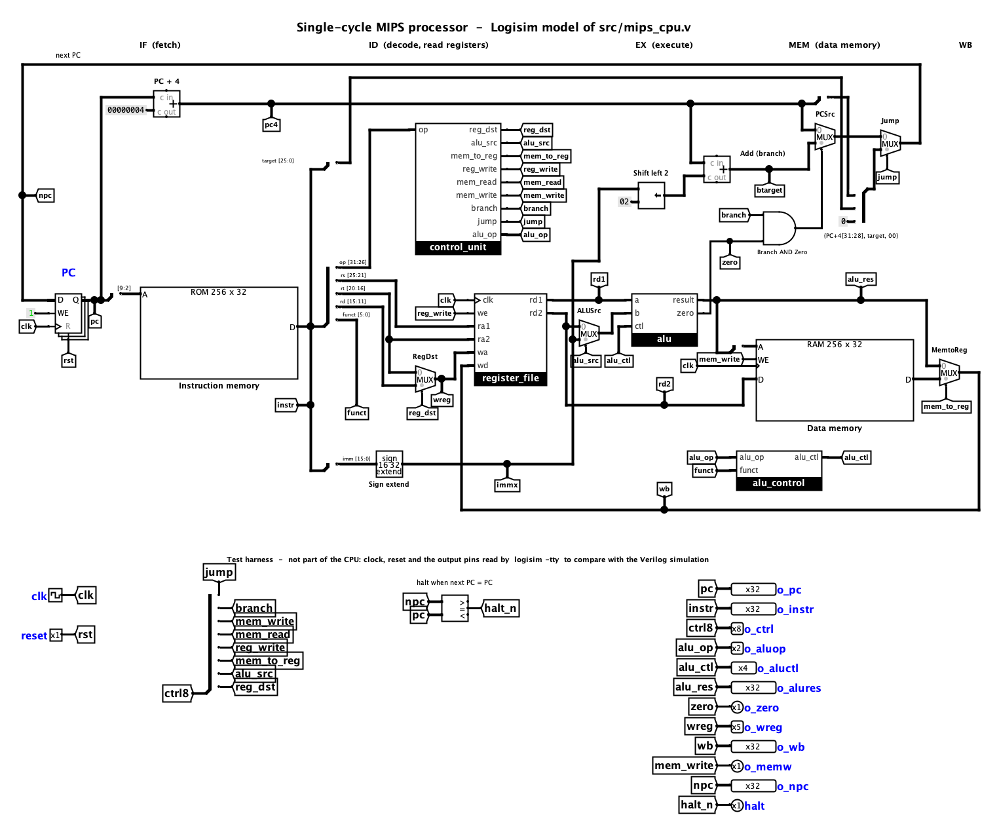

# Single-Cycle MIPS Processor with Memory Interface

A 32-bit single-cycle MIPS processor written in Verilog-2001 (Icarus Verilog compatible). Every instruction is fetched, decoded, executed and written back in one clock cycle. The processor core talks to a separate instruction memory and data memory through a **memory interface** (Harvard architecture).

MCA project, Phase I submission.

## Project links

| | Link |
|---|---|
| **Demo video**  | [Watch on Google Drive](https://drive.google.com/file/d/1OvmcGS92EaxGDMzltkKdzJ9j99zIK0Cn/view?usp=sharing) |
| **Project report**  | [`project-report/MCA-report.pdf`](project-report/MCA-report.pdf) |
| **Live simulator** | https://khushi-madan18.github.io/Single-Cycle-MIPS-Processor-with-Memory-Interface/ |
| **Source code** | https://github.com/khushi-madan18/Single-Cycle-MIPS-Processor-with-Memory-Interface |
| **Logisim circuit** | [`logisim/mips_single_cycle.circ`](logisim/mips_single_cycle.circ) |


## Team

| Member | Enrollment no. | Contribution |
|---|---|---|
| Manpreet Singh | 2401010263 | Interactive web simulator, project report and video (`ui/`, `project-report/`) |
| Avneet Singh | 2401010117 | ALU, datapath and instruction execution (`src/alu.v`, `src/alu_control.v`, `src/sign_extension.v`, `tools/mips_asm.py`, `programs/`) |
| Khushi | 2401010225 | Processor architecture and Logisim circuit (`docs/architecture.md`, `logisim/`, `docs/logisim/`) |
| Satvik Prasad | 2401020055 | Processor modules and RTL implementation (`src/mips_cpu.v`, `src/mips_core.v`, `src/control_unit.v`, `src/register_file.v`, `src/pc.v`, `synthesis/`) |
| Riya Yadav | 2401010390 | Memory, branching and testbench verification (`src/data_memory.v`, `src/instruction_memory.v`, `src/branch_jump_logic.v`, `testbench/`, `tools/run_tests.py`, `docs/waveforms/`) |


## Results at a glance

| Check | Result |
|---|---|
| Full regression (`make test`) | **9/9 passed**: ALU and control-unit unit tests, system test, 4 programs checked cycle by cycle against the Python golden model, web-UI model vs RTL, Logisim circuit vs RTL |
| Logisim circuit vs Verilog | 265/265 clock cycles match across the 4 sample programs |
| `array_sum.asm` | 54 cycles, CPI 1.00, result `110` |
| FPGA size (Xilinx Artix-7) | about 370 LUTs, under 2 % of an XC7A35T |

## Supported instructions

| Instruction | Type | Operation |
|---|---|---|
| ADD, SUB, AND, OR, SLT | R-type | `rd = rs op rt` |
| LW | I-type | `rt = mem[rs + imm]` |
| SW | I-type | `mem[rs + imm] = rt` |
| BEQ | I-type | `if (rs == rt) PC = PC + 4 + (imm << 2)` |
| ADDI | I-type | `rt = rs + imm` |
| J | J-type | `PC = {PC+4[31:28], addr, 2'b00}` |

## Folder structure

```
.
├── src/            Verilog design modules (one per file)
├── testbench/      unit, system and generic program testbenches
├── programs/       sample programs: .asm source, .mem machine code, .lst conversion listing
├── tools/          helper scripts: assembler, test runner, waveform plotter, Logisim builder (see tools/README.md)
├── ui/             interactive web simulator (open ui/index.html)
├── logisim/        the Logisim circuit (.circ) to open in Logisim-evolution + program images
├── synthesis/      Yosys scripts and the synthesis report
├── docs/           architecture.md, waveforms/ and logisim/ (circuit diagrams)
├── project-report/ IEEE-format project report (MCA-report.pdf)
├── video/          demo video subtitles (.srt); the video itself is on Google Drive
├── simulation/     generated .vvp / .vcd / trace files (git-ignored)
└── Makefile
```

## Modules

| File | Module | Role |
|---|---|---|
| `mips_cpu.v` | `mips_cpu` | **Top level**: core + instruction memory + data memory, debug ports |
| `mips_core.v` | `mips_core` | Datapath + control; instruction and data memory interfaces |
| `pc.v` | `pc` | Program counter register |
| `instruction_memory.v` | `instruction_memory` | 256-word ROM-style memory, async read, loaded from `IMEM_FILE` |
| `control_unit.v` | `control_unit` | Opcode → control signals |
| `register_file.v` | `register_file` | 32×32 registers, 2 async reads, 1 sync write, `$zero` hard-wired |
| `sign_extension.v` | `sign_extension` | 16 → 32 bit sign extension |
| `alu.v` | `alu` | ADD, SUB, AND, OR, SLT + zero flag |
| `alu_control.v` | `alu_control` | ALUOp + funct → ALU operation |
| `data_memory.v` | `data_memory` | 256-word RAM, async read, sync write, optional `DMEM_FILE` |
| `branch_jump_logic.v` | `branch_jump_logic` | PC+4, branch target, jump target, next-PC mux |

## Requirements

* [Icarus Verilog](https://steveicarus.github.io/iverilog/): `brew install icarus-verilog` (macOS) or `sudo apt install iverilog` (Ubuntu)
* Python 3 (standard library only), for the assembler and the test runner
* Optional: [Yosys](https://github.com/YosysHQ/yosys) for synthesis (`brew install yosys`), and GTKWave or [Surfer](https://surfer-project.org/) to view `.vcd` waveforms

All commands below are run from the repository root.

## Quick start

```bash
make test                     # run everything: unit tests + 4 programs checked against the golden model
make wave PROG=array_sum      # simulate one program and draw docs/waveforms/array_sum.svg
make synth                    # synthesis report (see synthesis/synthesis_report.md)
```

Without `make`:

```bash
python3 tools/run_tests.py
iverilog -g2001 -o simulation/mips_cpu.vvp src/*.v testbench/tb_mips_cpu.v
vvp simulation/mips_cpu.vvp
```

## Interactive simulator (web UI)

`ui/` is a browser-based simulator for this processor. It needs no build step or server-side code:

```bash
python3 -m http.server 8765 --directory ui     # then open http://localhost:8765
```

(Opening `ui/index.html` directly also works.)

* **Editor**: syntax highlighting, assembles as you type, inline errors, breakpoints (click a line number), sample programs, and loading your own `.asm` file.
* **Run controls**: step, step back, run with adjustable speed, run to halt, reset. Keyboard: `F10`/`→` step, `←` back, `Space` run, `F8` to halt.
* **Animated datapath**: the instruction flows through IF → ID → EX → MEM → WB. Active wires and blocks light up, control signals show their values, and live values sit on the wires. Hover any block to see which Verilog module it is.
* **Conversion**: every step from assembly text to tokens, register/label resolution, instruction format, bit fields, 32-bit binary and hex; then how the hardware decodes it into control signals, reads registers, sign-extends, computes in the ALU, accesses memory, writes back and picks the next PC.
* **Registers / Data memory** (reads and writes highlighted), **Stats** (cycles, CPI, instruction mix), **Machine Code** listing (download `.mem` files for the Verilog testbench), **Cycles** timeline.
* **RTL Verification**: each executed cycle is compared with the real Verilog simulation trace (`ui/data/rtl_traces.js`, exported from `testbench/tb_program.v`). For your own programs, run `make sim PROG=name` and load `simulation/name_trace.txt`.

`ui/js/isa.js` is a JavaScript port of `tools/mips_asm.py`. `tools/run_tests.py` checks that it matches the Verilog RTL on every cycle of every sample program (`tools/check_ui_model.js`).

## From assembly to machine code

`tools/mips_asm.py` is a two-pass assembler for the supported instruction set. It understands labels, `.data`/`.word` sections and the `nop`/`halt` pseudo-instructions.

```bash
python3 tools/mips_asm.py programs/array_sum.asm --run   # assemble + run on the golden model
python3 tools/mips_asm.py --explain 0x8C0B0000           # decode one 32-bit word
```

Each program produces:

* `programs/<name>.mem`: instruction-memory image, loaded by `$readmemh`
* `programs/<name>_data.mem`: data-memory image (when the program has a `.data` section)
* `programs/<name>.lst`: the conversion listing, showing for every instruction its format and fields (opcode / rs / rt / rd / shamt / funct or immediate / target), the 32-bit binary and the hex word

Example from `array_sum.lst`:

```
0x00000004  lw   $t1, n($zero)               ->  0x8C090020   (I-type)
            opcode |   rs  |   rt  |    immediate
            100011 | 00000 | 01001 | 0000000000100000
            opcode=35, rs=0, rt=9, imm=32
```

## Sample programs

| Program | What it does | Instr. | Cycles | Result |
|---|---|---:|---:|---|
| `basic_test.asm` | every instruction once (the team's original test program) | 12 | 10 | `$t7 = 77`, `mem[0] = 15` |
| `array_sum.asm` | sum of 8 signed words | 11 | 54 | `110` |
| `max_search.asm` | maximum of 10 signed words (SLT + BEQ) | 15 | 73 | `92` |
| `factorial.asm` | 6! using multiplication by repeated addition | 17 | 128 | `720` |

Each `.asm` file lists its expected results as `# EXPECT` lines, which the test runner checks.

## Verification

`python3 tools/run_tests.py` runs:

1. **Unit tests**: `tb_alu.v` (every ALU operation, signed SLT, overflow wrap, zero flag, ALU-control decoding) and `tb_control_unit.v` (all 9 control signals for every opcode).
2. **System test**: `tb_mips_cpu.v`, the original self-checking test, run on `programs/basic_test.mem`.
3. **Program tests**: each `programs/*.asm` is assembled, run on the Python **golden model**, and simulated on the Verilog CPU with `tb_program.v`. The runner then compares, **for every clock cycle**, the PC, instruction, all control signals, ALU control and result, zero flag, write-back register and data, memory-write enable and data, and the next PC. It also compares the final 32 registers and 256 data-memory words, and checks the `# EXPECT` values.

The checker was itself tested by deliberately breaking the control unit (SW also writing a register). The regression flagged the exact cycle and signal.

Each program run also writes `simulation/<name>.vcd` (full waveform), `simulation/<name>_trace.txt` (per-cycle log) and `simulation/<name>_state.txt` (final state). `docs/waveforms/*.svg` are timing diagrams drawn from these traces.

## Logisim circuit

[`logisim/mips_single_cycle.circ`](logisim/mips_single_cycle.circ) is a working Logisim-evolution model of the processor, drawn like the textbook datapath with real wires. It is built from standard gates, comparators, adders, multiplexers, registers, a decoder, ROM and RAM, with one subcircuit per Verilog module (`control_unit`, `alu_control`, `alu`, `register_file`). Open it in Logisim-evolution and press Ctrl+T to step one clock cycle. Diagrams of all circuits are in [`docs/logisim/`](docs/logisim/).



`python3 tools/logisim/verify_logisim.py` runs all 4 sample programs in Logisim (headless) and checks that every clock cycle and the final data memory match the Verilog simulation (265/265 cycles). It is part of `tools/run_tests.py` when Logisim is installed. See [`logisim/README.md`](logisim/README.md).

## Synthesis

See [`synthesis/synthesis_report.md`](synthesis/synthesis_report.md). In short: the core is 4,795 generic gates and 1,056 flip-flops. On a Xilinx Artix-7 the complete system needs about 370 LUTs, 12 RAM32M cells (register file) and 32 RAM256X1S cells (data memory), well under 2 % of an XC7A35T.

## Notes and limitations

- Memory accesses must be word-aligned (the low two address bits are ignored).
- Memories hold 256 words; larger addresses wrap around.
- Unsupported opcodes behave like a NOP. No exceptions, overflow detection or delay slots.
- Reset is synchronous and active-high; it only resets the PC. Registers and memories are initialised at start-up.
- A program "halts" by jumping to itself (`halt` pseudo-instruction); the testbench detects this.
- Assembler-generated `.mem` files are padded to 256 words so `$readmemh` fills the whole memory.

## References

1. D. A. Patterson and J. L. Hennessy, *Computer Organization and Design: The Hardware/Software Interface*, 5th ed., Morgan Kaufmann, 2014.
2. MIPS Technologies, *MIPS32 Architecture for Programmers, Volume II: The MIPS32 Instruction Set*, Rev. 2.00, 2003.
3. *IEEE Standard for Verilog Hardware Description Language*, IEEE Std 1364-2005, 2006.
4. Icarus Verilog: https://steveicarus.github.io/iverilog/
5. Yosys Open SYnthesis Suite: https://yosyshq.readthedocs.io/
6. Logisim-evolution: https://github.com/logisim-evolution/logisim-evolution

The full reference list is in the [project report](project-report/MCA-report.pdf).
